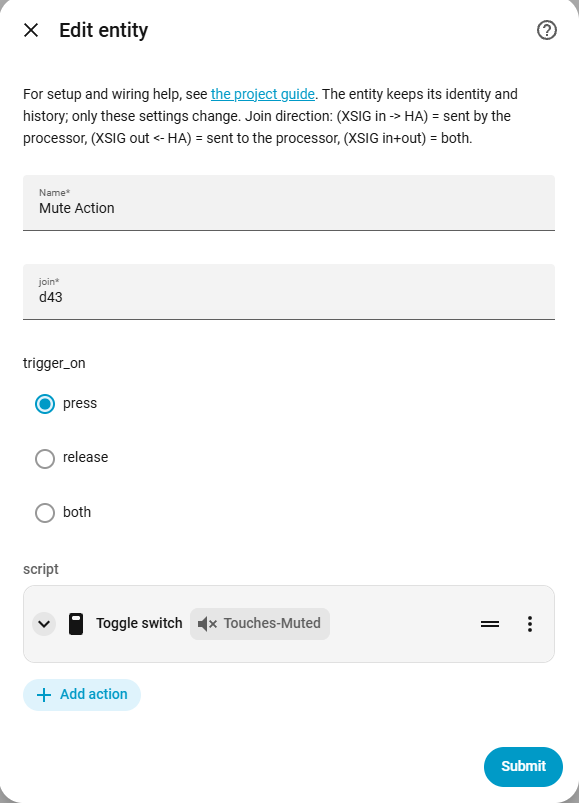
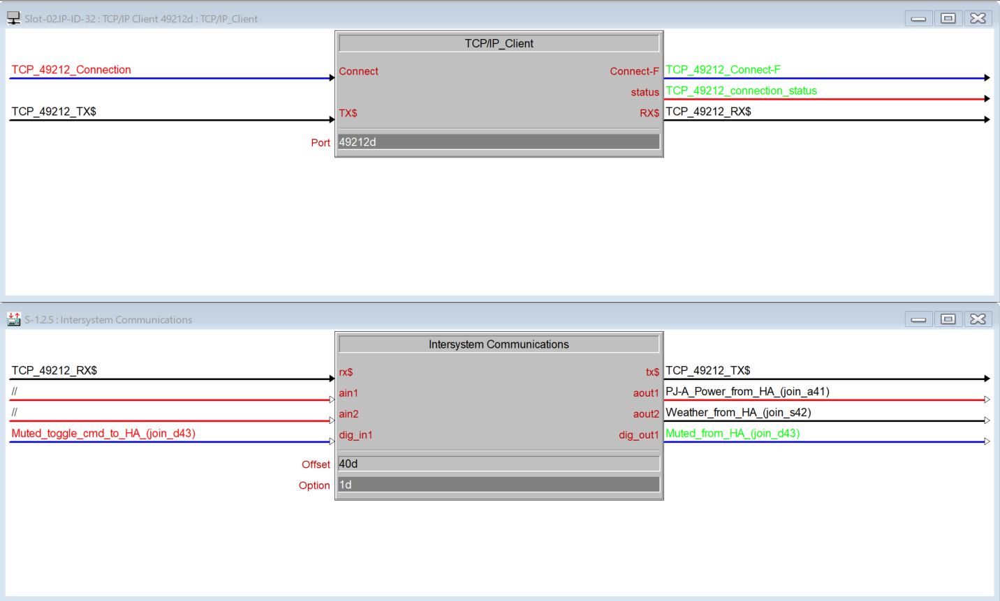

# Action: Crestron → Home Assistant

[← All configuration guides](README.md) · [Wiring reference](../WIRING.md)

An **Action** runs a Home Assistant action sequence when the Crestron processor sends a configured join. It is a bridge rule, not an entity.

## Form options

| Option | Required? | Meaning |
|---|---|---|
| Name | Yes | Descriptive rule name for the options list and logs. |
| Join to react to | Yes | Typed join: `d1`–`d4096`, `a1`–`a1024`, or `s1`–`s1024`. The type and number must match the signal sent into the XSIG **in** side. |
| When to trigger a digital join | Yes; defaults to `press` | `press` runs on low→high (default), `release` on high→low, or `both` on either transition. This setting only changes digital behavior; analog and serial joins run for each received update. |
| Actions to run | Yes | Home Assistant action sequence, configured with HA’s action editor. The incoming join value is available as the `value` variable (`{{ value }}`). |

## Value passed to the action

- Digital joins provide a boolean (`true` or `false`). The trigger option chooses the edge.
- Analog joins provide an integer.
- Serial joins provide a string.

For example, use the `value` variable in a service/action field that accepts templates. A serial action could pass `{{ value }}` as a notification message; an analog action could pass it as a numeric target. The editor’s selector and fields depend on the Home Assistant action you choose.

## Wiring and safety

Connect the configured join to XSIG **in**. Ensure the chosen number/type does not unintentionally activate another rule. HA actions execute with Home Assistant’s normal permissions; carefully review service targets and templates. Rules are independent and can be edited in the integration Configure menu.

