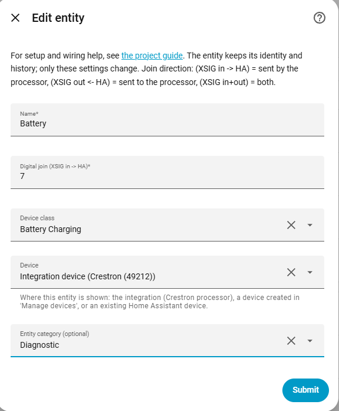
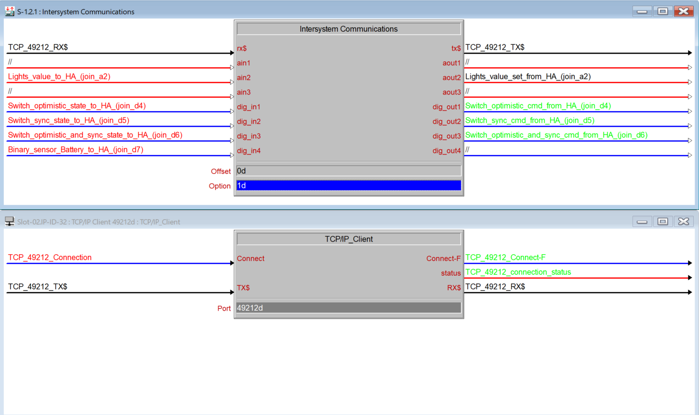

# Binary sensor

[← All configuration guides](README.md) · [Wiring reference](../WIRING.md)

A binary sensor reports a digital state received from Crestron (**XSIG in → HA**). It is read-only from Home Assistant.

## Form options

| Option | Required? | Meaning |
|---|---|---|
| Name | Yes | Name shown in Home Assistant. |
| Digital join | Yes | Join number 1–4096, received from Crestron. Low is off; high is on. |
| Device class | Optional | Select a class that describes the signal, such as `door`, `motion`, `occupancy`, `connectivity`, or `problem`. HA may change its wording/icon based on this selection. |
| Device / Entity category | Optional | See [shared form options](README.md#shared-form-options). |

## Wiring and behavior

Connect the SIMPL signal to the XSIG **in** side of the configured digital join. Use a binary sensor for state/feedback (door open, motion detected, fault active). For a HA-controlled momentary digital output, use [Button](button.md); for a controllable maintained state use [Switch](switch.md).

