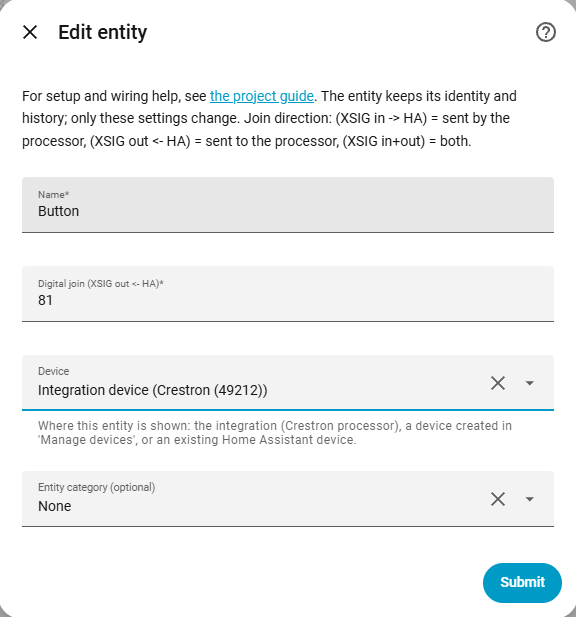
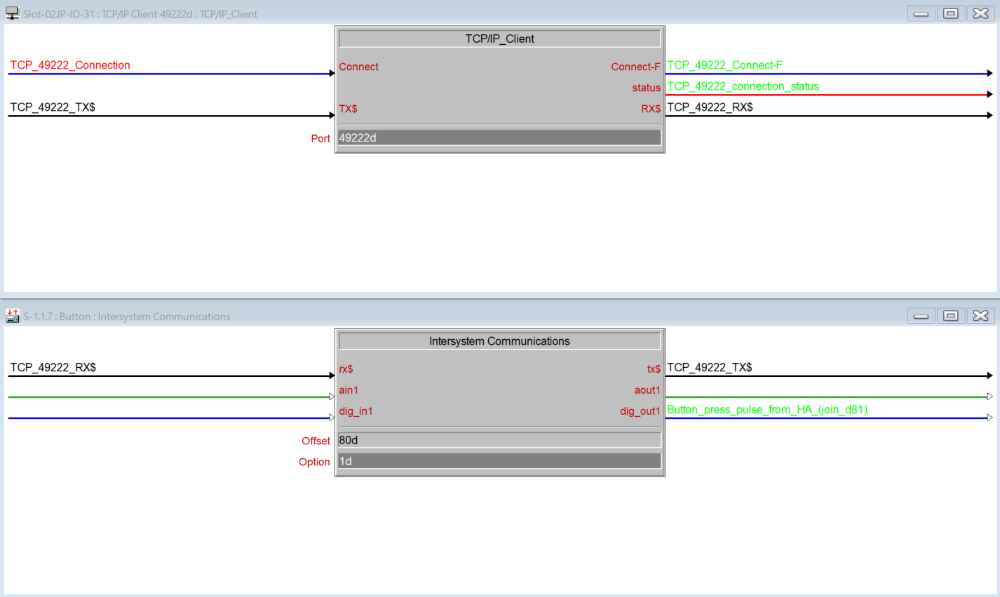

# Button

[← All configuration guides](README.md) · [Wiring reference](../WIRING.md)

A button sends a momentary digital pulse for one-shot commands (**XSIG out ← HA**). Use it for actions such as a relay trigger or command that Crestron handles on the rising edge.

## Form options

| Option | Required? | Meaning |
|---|---|---|
| Name | Yes | Name shown in Home Assistant. |
| Digital join | Yes | Join number 1–4096 to pulse. |
| Device / Entity category | Optional | See [shared form options](README.md#shared-form-options). |

## Wiring and behavior

When pressed, the integration sends digital high, then sends low after approximately 200 ms. Connect the XSIG **out** signal to the SIMPL logic that receives the pulse. No feedback or optimistic-state setting is needed. For a maintained on/off state, use a [Switch](switch.md).

