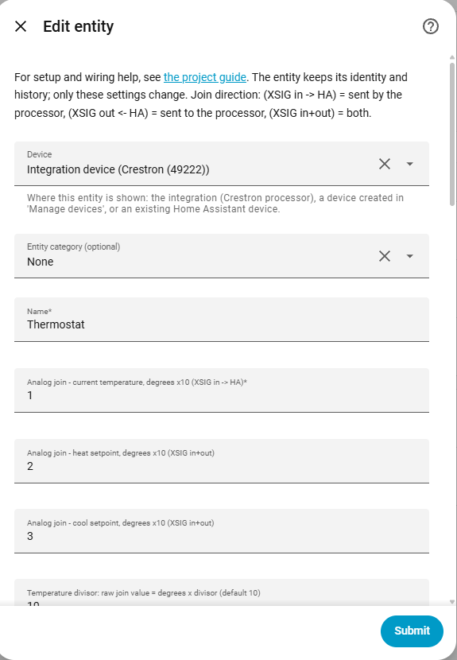
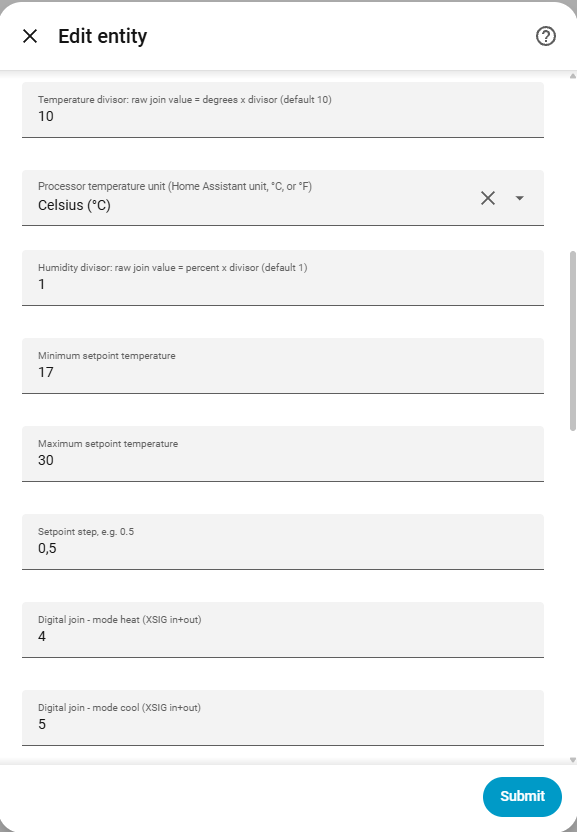
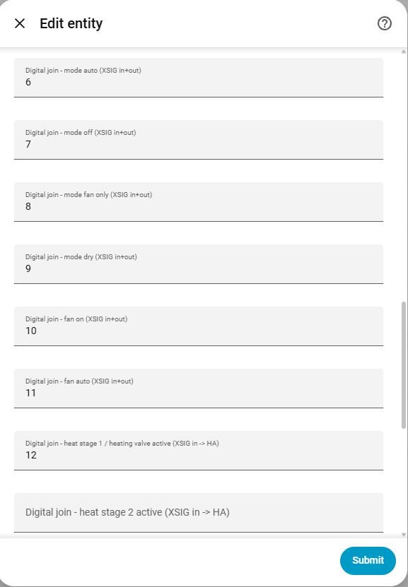
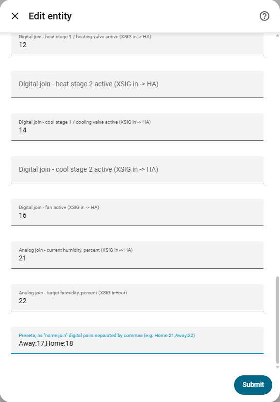
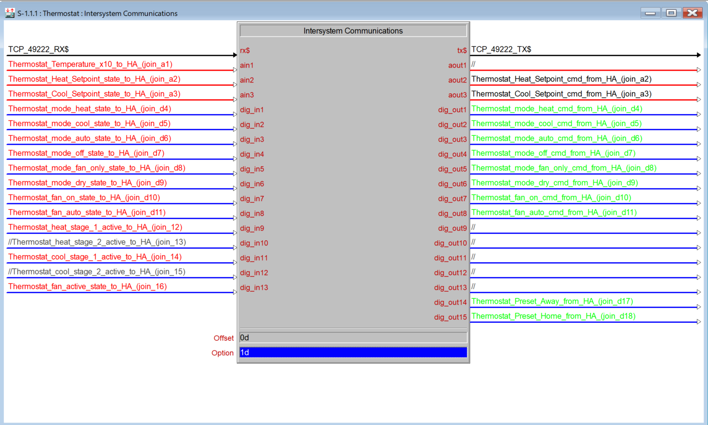
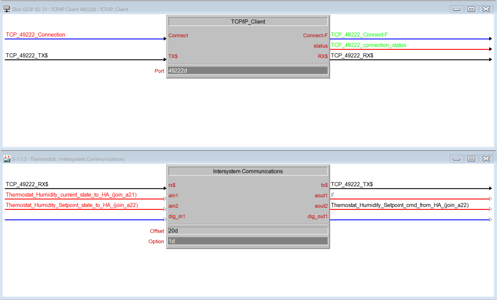

# Climate / thermostat

[← All configuration guides](README.md) · [Wiring reference](../WIRING.md)

A climate entity requires only a **Name** and the current-temperature feedback join. Setpoints and all operating modes are optional. Add only features supported by the thermostat/program; Home Assistant only exposes modes for which joins are configured.

## Form options

| Option | Required? | Meaning |
|---|---|---|
| Name | Yes | Name shown in Home Assistant. |
| Current temperature (`reg_temp_join`) | Yes | Analog feedback, **XSIG in → HA**. The raw value is degrees multiplied by the temperature divisor. |
| Heat setpoint | Optional | Analog **in+out** join for heat target. On its own this creates a single setpoint; paired with Cool setpoint it is the low end of a heat/cool range. |
| Cool setpoint | Optional | Analog **in+out** join for cool target. With Heat setpoint, HA presents a range; alone, it is a single target. |
| Temperature divisor | Optional; default 10 | Encoding scale: raw value = degrees × divisor. At 10, `215` means 21.5°. It must be greater than zero. |
| Processor temperature unit | Optional; default Home Assistant unit | Tell the integration what units SIMPL uses: Home Assistant unit, Celsius, or Fahrenheit. Values are converted between the processor and HA units. Choose the program’s actual unit. |
| Humidity divisor | Optional; default 1 | Raw humidity = percent × divisor. Used for both current and target humidity; must be greater than zero. |
| Minimum / Maximum setpoint temperature | Optional | Setpoint limits presented to Home Assistant, in HA’s temperature unit. |
| Setpoint step | Optional | HA setpoint increment, e.g. `0.5` or `1`. |
| Mode joins: Heat, Cool, Auto, Off, Fan only, Dry | Optional | Digital **in+out** joins. Each configured mode appears in HA; commands select one and clear the other configured mode joins. |
| Fan On / Fan Auto | Optional | Digital **in+out** joins. Configuring either join exposes fan controls in HA; On and Auto commands are sent only when their corresponding joins are configured. |
| H1 / H2 / C1 / C2 / FA | Optional | Digital feedback **XSIG in → HA**: heat stage 1/2, cool stage 1/2, fan active. These are read-only and report HVAC action, not operating mode. |
| Current humidity | Optional | Analog feedback **XSIG in → HA**, scaled by Humidity divisor. |
| Target humidity | Optional | Analog **XSIG in+out** join, scaled by Humidity divisor. Enables HA target-humidity control. |
| Presets | Optional | Comma-separated `Name:digital_join` pairs, e.g. `Home:21,Away:22,Sleep:23`. Selecting a preset activates its join and clears the other preset joins. Digital join range is 1–4096. |
| Device / Entity category | Optional | See [shared form options](README.md#shared-form-options). |

## Wiring guidance

- A simple thermostat needs current temperature plus at least one setpoint join if HA should change the target. One setpoint is single-target; two setpoints produce a low/high range.
- Mode and fan joins are command/state bits (**in+out**); wire them as maintained levels. Stage/valve joins are feedback bits only and help HA show Heating, Cooling, Fan or Idle.
- Do not use the stage feedback joins as mode-command joins. For the actual active heating/cooling valve, return its state to H1/C1 (and additional stages to H2/C2).
- Values are integer analogs. Choose the divisor so the desired temperature is representable by an integer. Unit conversion affects temperature values; humidity is scaled separately.
- Preset names and joins must be separated by commas; each pair is `name:join`.

