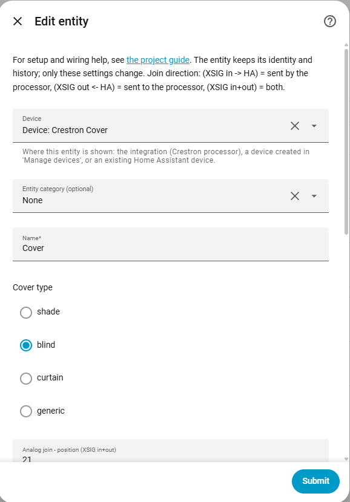
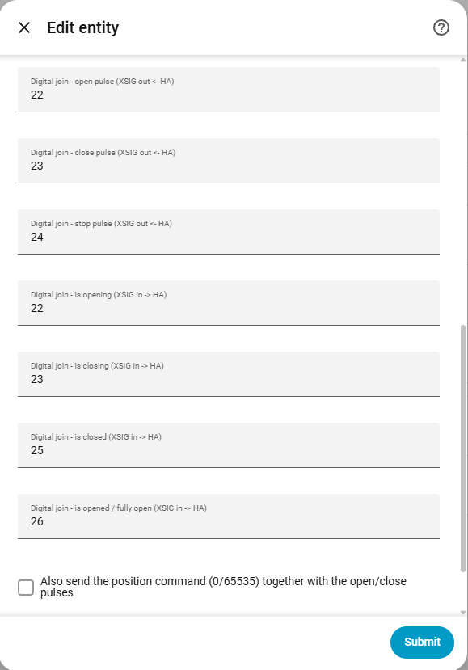
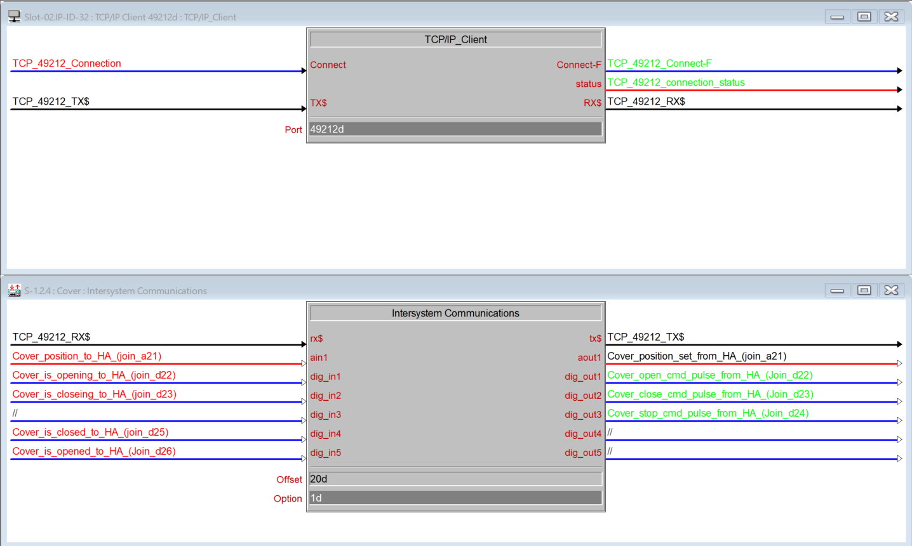

# Cover

[← All configuration guides](README.md) · [Wiring reference](../WIRING.md)

A cover can combine digital pulse commands, an analog position command and digital feedback. Only the **Name** is required; configure the signal paths supported by your SIMPL program.

## Form options

| Option | Required? | Meaning |
|---|---|---|
| Name | Yes | Name shown in Home Assistant. |
| Cover type | Optional | `Shade`, `Blind`, `Curtain` or `Generic`; controls HA classification/icon/semantics only. |
| Open / Close / Stop join | Optional | Digital command pulses, **XSIG out ← HA**. Each configured command is exposed as an HA feature. |
| Position join | Optional | Analog 0–65535, **XSIG in+out**. HA percentage 0–100 maps to 0–65535 (closed=0, open=65535). Enables position and, when no pulse is configured, open/close commands. |
| Is opening / Is closing | Optional | Digital feedback, **XSIG in → HA**. |
| Is closed / Is opened | Optional | Digital feedback, **XSIG in → HA**. `Is opened` confirms fully open; if no closed signal exists, it can provide the open/closed state. |
| Position commands | Optional; off by default | Also send position 65535/0 when opening/closing with pulse joins configured. Without this option, a configured pulse is used by itself; if the corresponding pulse is absent, the position join can still command that direction. |
| Optimistic | Optional; off by default | Mirror position commands locally without waiting for a position echo. |
| Device / Entity category | Optional | See [shared form options](README.md#shared-form-options). |

## Wiring and behavior

- Joins are independently optional and can be combined. Wire only the directions you use.
- Open/close/stop digital commands are pulses generated by HA. Opening/closing can send both a pulse and a position value when **Position commands** is enabled.
- Position uses the same analog join for read and write. Send it back from the processor if HA should show actual position.
- Feedback joins describe activity/state; they do not issue movement commands.

