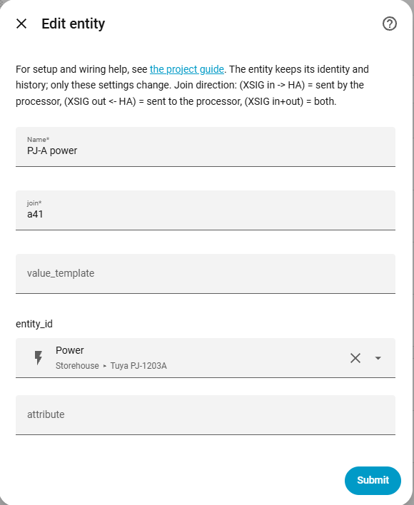
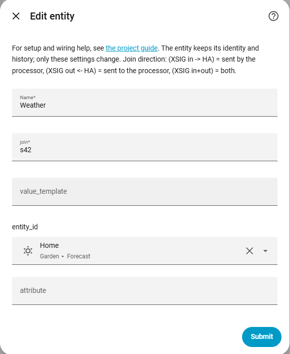
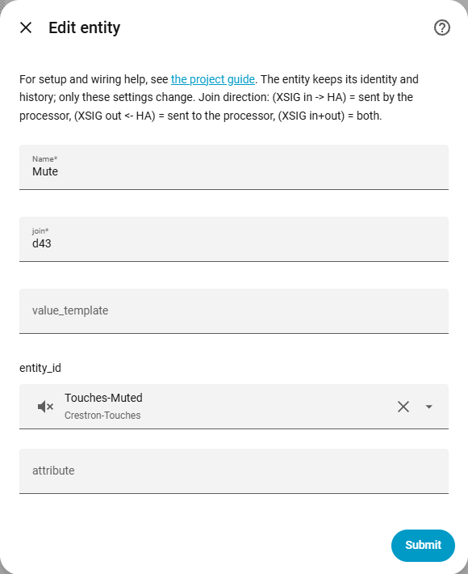
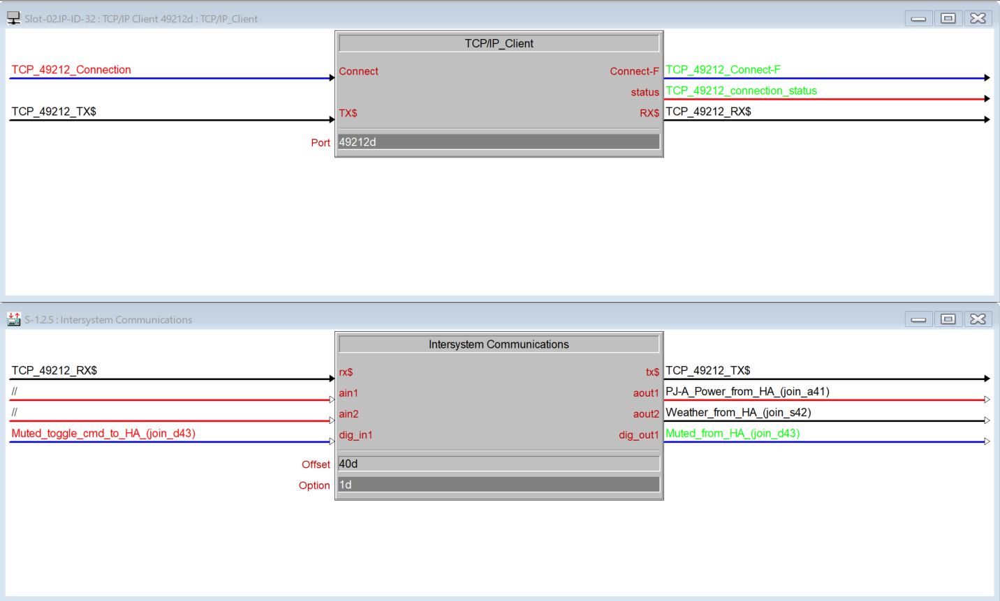

# Expose: Home Assistant → Crestron

[← All configuration guides](README.md) · [Wiring reference](../WIRING.md)

An **Expose** pushes a Home Assistant value to a Crestron XSIG join whenever its source changes. It is a bridge rule, not a Home Assistant entity. Exposes are also resent when the processor reconnects or requests a full status sync.

## Form options

| Option | Required? | Meaning |
|---|---|---|
| Name | Yes | Descriptive rule name, used in the integration configuration/logs. |
| Join to write to | Yes | Typed join: `d1`–`d4096` (digital), `a1`–`a1024` (analog), or `s1`–`s1024` (serial). Prefix determines how the value is converted. |
| Value template | Optional source | A Home Assistant Jinja template, e.g. `{{ states('sensor.outdoor_temperature') }}`. Use this for formatting, calculations, or combining entities. |
| Entity | Optional source | Select an HA entity. If Attribute is blank, its state is sent; otherwise the selected attribute is sent. |
| Attribute | Optional | Attribute name on the selected entity, e.g. `brightness`. Use only with an entity source. |

Provide a value template **or** an entity (and optionally an attribute). If both a template and entity are filled in, the template takes precedence. The source must produce a value that can be represented by the target join type.

## Value conversion

- **Digital (`d`)**: recognized true-like values (`on`, `true`, `1`, `yes`, `home`) become high; false-like values (`off`, `false`, `0`, `no`, `not_home`, `unavailable`, `unknown`, empty) become low. Other text is skipped with a warning.
- **Analog (`a`)**: result is parsed as a number and converted to an integer (`int(float(value))`). Use a template to scale/round it as required; the XSIG value range is 0–65535.
- **Serial (`s`)**: result is sent as text, with the serial size/encoding limits described in the [wiring guide](../WIRING.md).

Examples:

```jinja
{{ states('sensor.room_temperature') | float(0) * 10 }}
{{ state_attr('light.living_room', 'brightness') | int(0) }}
{{ is_state('binary_sensor.front_door', 'on') }}
```

For an analog temperature join where SIMPL expects tenths of a degree, `20.5` should be exposed as `205`.

## Wiring and troubleshooting

Connect the configured join to the XSIG **out** side. Check the prefix matches the SIMPL signal type and the value is valid for that type. A template that renders `unknown` or other non-numeric text cannot be written to an analog join. Exposes are tracked when HA entities/attributes change, and are pushed again during reconnect/full-sync.








