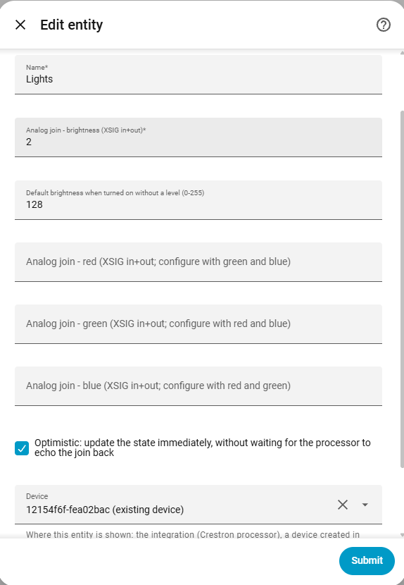
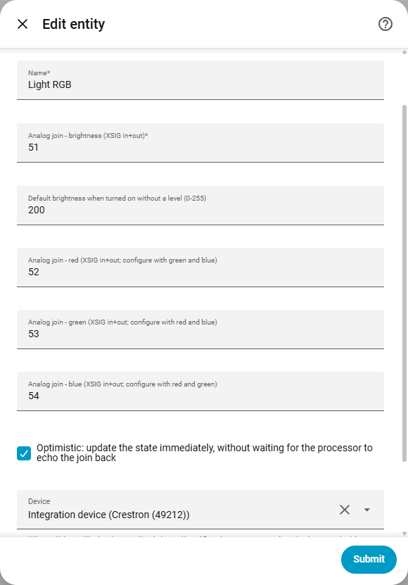
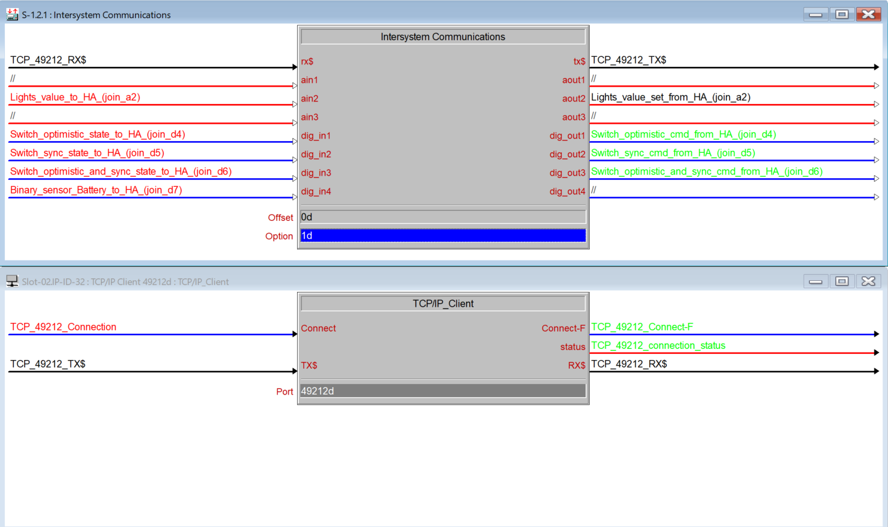
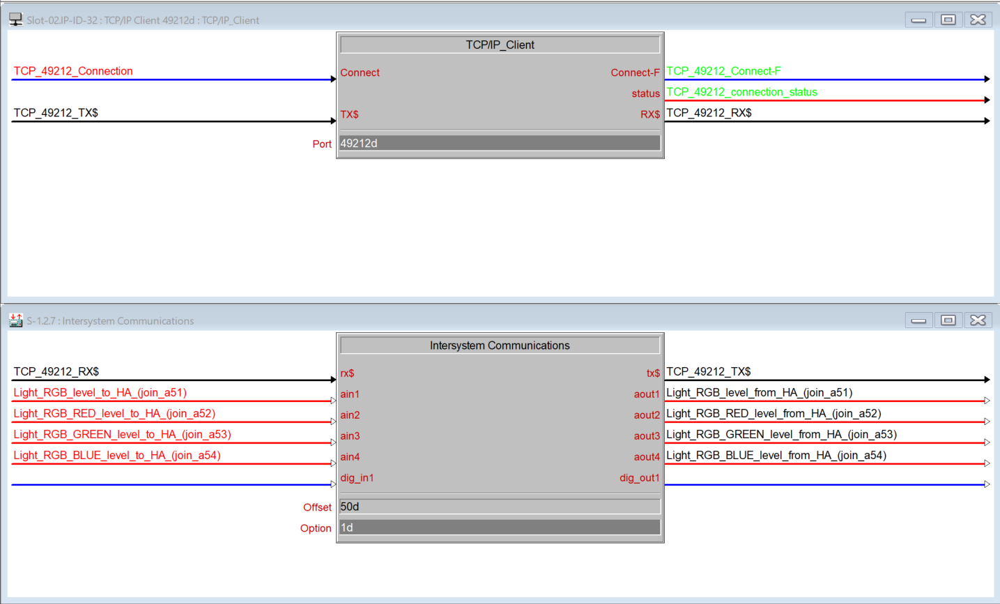

# Light

[← All configuration guides](README.md) · [Wiring reference](../WIRING.md)

A light uses analog joins. Brightness-only is always available; configuring all three RGB joins changes the entity to RGB mode.

## Form options

| Option | Required? | Meaning |
|---|---|---|
| Name | Yes | Name shown in Home Assistant. |
| Brightness join | Yes | Analog join 1–1024, **XSIG in+out**. HA brightness 0–255 is scaled to/from the XSIG analog range 0–65535. Brightness zero means off. |
| Default brightness | Optional; default 128 | HA brightness (0–255) used when turned on without a requested level. |
| Red, Green, Blue joins | Optional, but all three must be set together | Three distinct analog joins, each **XSIG in+out**. Each HA RGB channel 0–255 is scaled to/from 0–65535. Each RGB join must differ from brightness and the other color joins. Leave all three empty for brightness-only operation. |
| Optimistic | Optional; off by default | Update HA immediately after sending, without awaiting a processor echo. |
| Device / Entity category | Optional | See [shared form options](README.md#shared-form-options). |

## Wiring and behavior

- Use one analog join for brightness-only setups. For color control wire the brightness join and all three channel joins.
- HA “turn on” without an explicit brightness uses the configured default. “Turn off” writes zero to the brightness join.
- RGB joins do not replace the required brightness join. Configure them only if the Crestron program supports RGB feedback/commands.
- Keep every join number distinct; the form rejects incomplete or duplicate RGB assignments.

