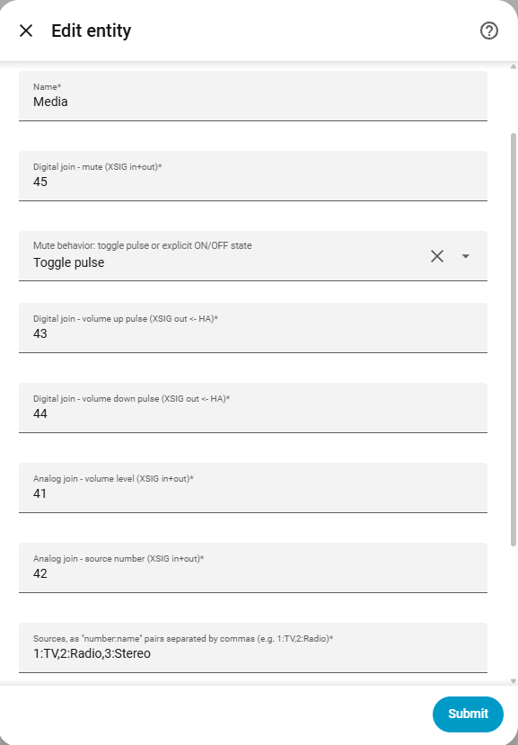
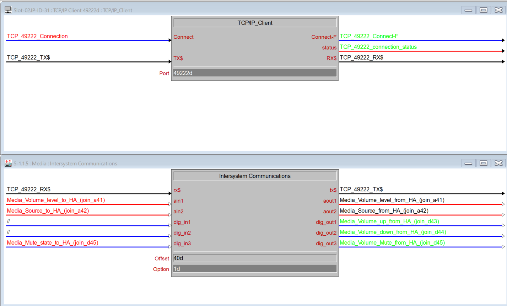

# Media player

[← All configuration guides](README.md) · [Wiring reference](../WIRING.md)

This entity controls mute, volume and source selection. It represents the selected source as on/off; it does not provide transport controls such as play/pause.

## Form options

| Option | Required? | Meaning |
|---|---|---|
| Name | Yes | Name shown in Home Assistant. |
| Mute join | Yes | Digital **in+out** feedback/command join. |
| Mute behavior | Optional; **Toggle pulse** by default | Toggle pulse sends a momentary pulse whenever HA mute is clicked; use when SIMPL toggles mute. **Set requested state** writes the requested on/off level and updates HA immediately; use when the processor accepts an explicit mute state. |
| Volume up / Volume down joins | Yes | Digital pulses **XSIG out ← HA**, triggered by HA volume-step controls. |
| Volume join | Yes | Analog **in+out**, raw range 0–65535 maps to HA volume 0.0–1.0. |
| Source number join | Yes | Analog **in+out**. Value 0 means off; matching a configured source number selects that source. HA on writes 1. |
| Sources | Required field; may be empty | Comma-separated `number:name` pairs, e.g. `1:TV,2:Radio,3:Bluetooth`. Numbers must be in the analog-value range 0–65535 and names must be non-empty. The selected number is displayed as the matching name. |
| Device / Entity category | Optional | See [shared form options](README.md#shared-form-options). |

## Wiring and behavior

- Wire volume and source analog joins both ways if Crestron changes those values and HA should reflect them.
- Mute mode should match SIMPL logic: Toggle pulse is not an explicit state command; Set requested state is not a toggle pulse.
- Volume up/down are pulses from HA to Crestron. The volume level join carries the actual level.
- Source list entries map the analog source number to the human-readable HA source name. A number not listed cannot be selected by name in HA.
- Set the source-number join to zero to indicate off; any nonzero number indicates on.

