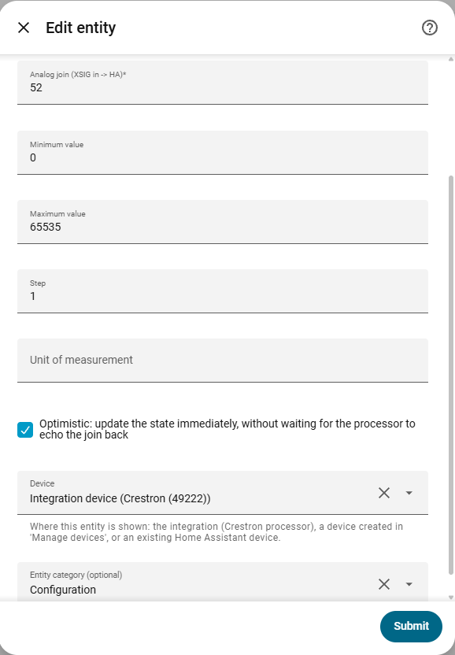
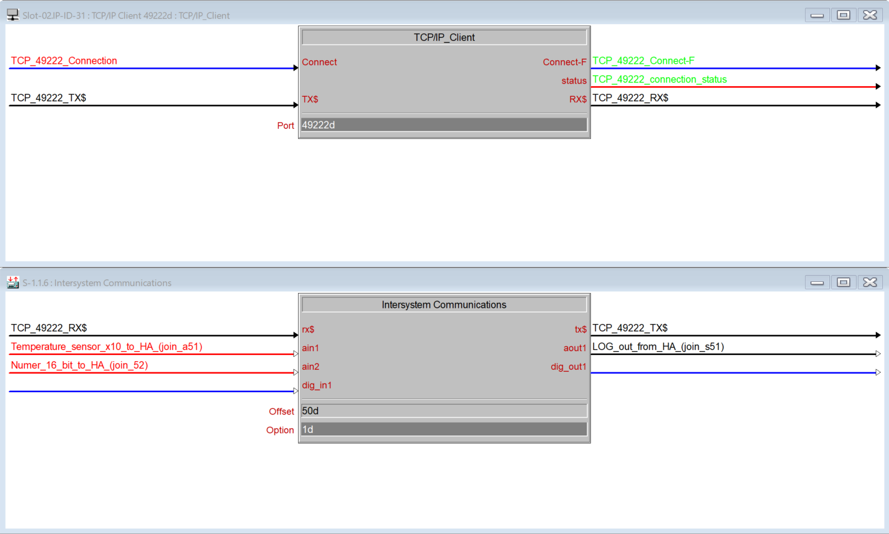

# Number

[← All configuration guides](README.md) · [Wiring reference](../WIRING.md)

A number entity gives Home Assistant a slider/number box for writing an analog join (**XSIG out ← HA**). If the processor returns the same join on XSIG in, HA displays that feedback.

## Form options

| Option | Required? | Meaning |
|---|---|---|
| Name | Yes | Name shown in Home Assistant. |
| Analog join | Yes | Join number 1–1024. Written by HA; the XSIG analog value must be an integer in 0–65535. |
| Minimum value | Optional; default 0 | Lowest allowed HA value. |
| Maximum value | Optional; default 65535 | Highest allowed HA value; must be greater than the minimum. |
| Step | Optional; default 1 | Slider/box increment. It must be a positive integer because XSIG analog values are integers. |
| Unit of measurement | Optional | Display unit such as `%`, `°C`, or a custom unit; this does not scale the transmitted value. |
| Optimistic | Optional; on by default | Show the value immediately after sending rather than waiting for processor feedback. Turn it off for feedback-driven display. |
| Device / Entity category | Optional | See [shared form options](README.md#shared-form-options). |

## Wiring and behavior

- The configured range must fit XSIG’s analog range 0–65535. HA values are sent as integers; this entity does not apply scaling/division.
- Choose min, max and step to match the analog quantity in your SIMPL program. A unit label is informational only.
- To show actual processor state, wire the analog join back on XSIG **in** and disable Optimistic.

