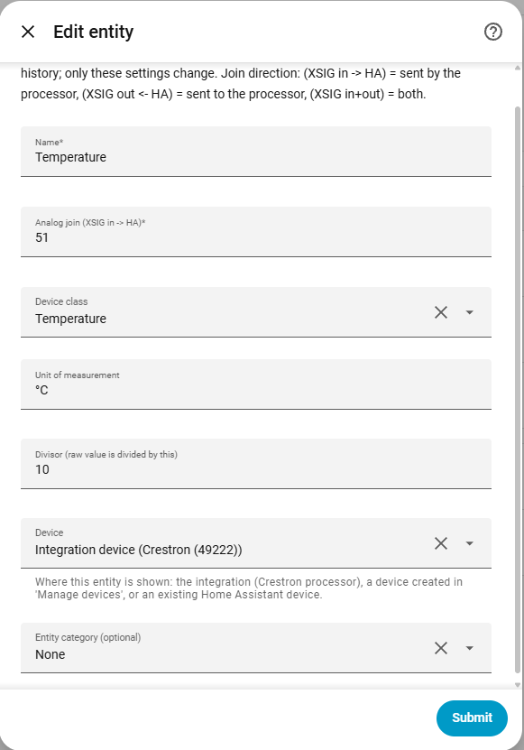
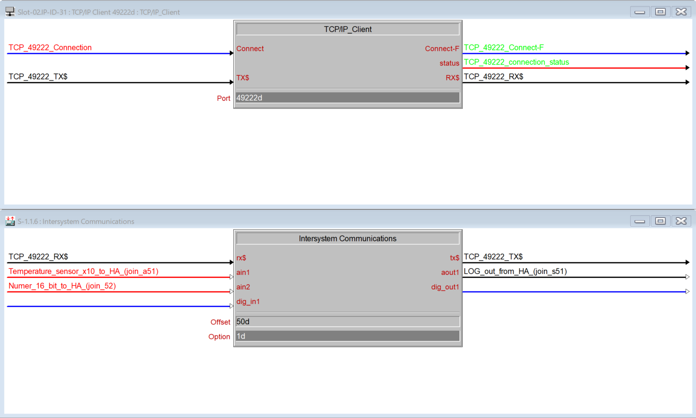

# Sensor

[← All configuration guides](README.md) · [Wiring reference](../WIRING.md)

A sensor reads an analog value sent by the Crestron processor (**XSIG in → HA**). It does not send commands to Crestron.

## Form options

| Option | Required? | Meaning |
|---|---|---|
| Name | Yes | Name shown in Home Assistant. |
| Analog join | Yes | Join number 1–1024, received from the processor. Raw values are 0–65535. |
| Device class | Optional | Select a Home Assistant sensor class (for example `temperature`, `humidity`, `power`, `energy`, `battery`). Choose one matching the physical quantity; it may affect display and unit validation in HA. |
| Unit of measurement | Optional | Display unit such as `°C`, `%`, `W`, or a custom unit. Must be compatible with the selected device class where HA requires it. |
| Divisor | Optional; default 1 | Reported value is `raw analog value ÷ divisor`. Use e.g. 10 when the processor sends tenths (raw `215` becomes `21.5`). Must be a positive integer. |
| Device / Entity category | Optional | See [shared form options](README.md#shared-form-options). |

## Wiring and behavior

1. Drive the configured analog **in** join from the SIMPL value to monitor.
2. Set the divisor to match the scale encoded by the program. A divisor does not change the value transmitted on XSIG.
3. Leave class or unit blank when no suitable standard classification applies. Avoid a unit inconsistent with the class.

