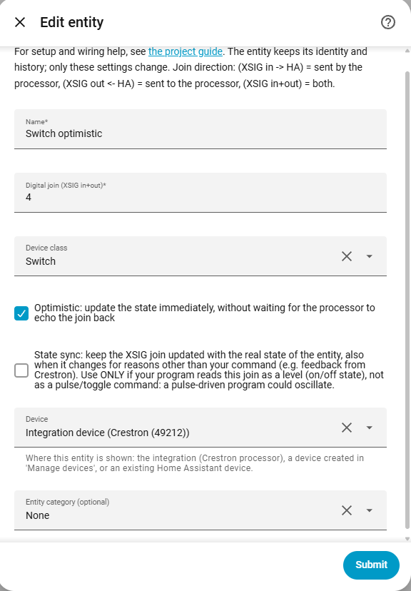
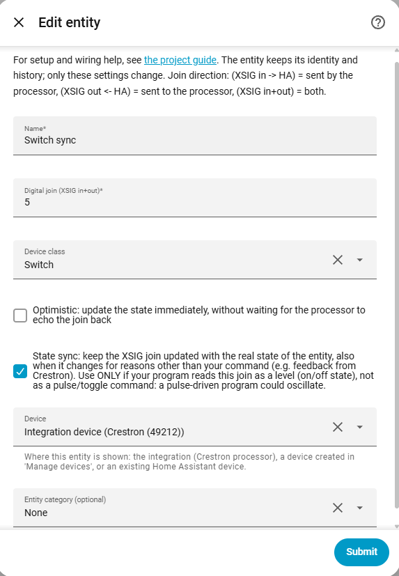
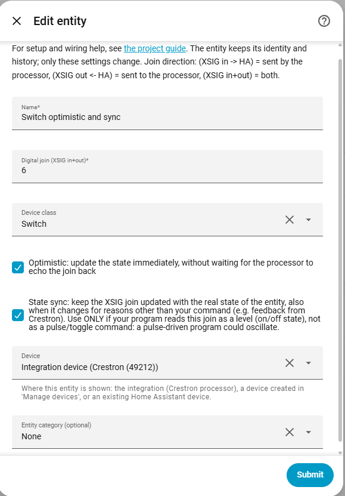
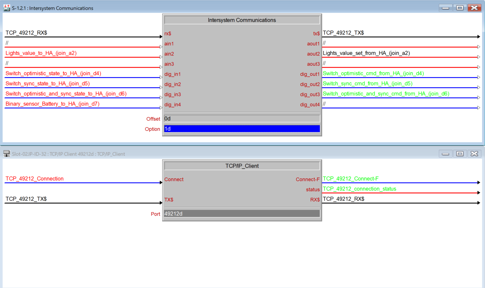

# Switch

[← All configuration guides](README.md) · [Wiring reference](../WIRING.md)

A switch is a bidirectional digital join: Home Assistant writes a command and Crestron can return the resulting state. Use it for a maintained level/state, not for a pulse-only command.

## Form options

| Option | Required? | Meaning |
|---|---|---|
| Name | Yes | Name shown in Home Assistant. |
| Digital join | Yes | Join number, 1–4096. **XSIG in+out**: HA writes on/off and Crestron should feed the current state back. |
| Device class | Optional | `Switch` (generic) or `Outlet` (electrical outlet). Changes HA presentation, not the XSIG signal. |
| Optimistic | Optional; off by default | Reflect the command immediately instead of waiting for Crestron feedback. Enable if there is no feedback. |
| State sync | Optional; off by default | Send the entity’s actual state to this join whenever it changes, including changes from other HA sources. Use only when SIMPL treats the join as a maintained level. A pulse/toggle program can oscillate if this is enabled. |
| Device / Entity category | Optional | See [shared form options](README.md#shared-form-options). |

## Wiring and behavior

1. Connect the same digital join on XSIG **in** and **out** for command plus feedback.
2. Leave Optimistic off when the processor echoes state; feedback remains authoritative.
3. For pulse/toggle logic, use a [Button](button.md) instead.

