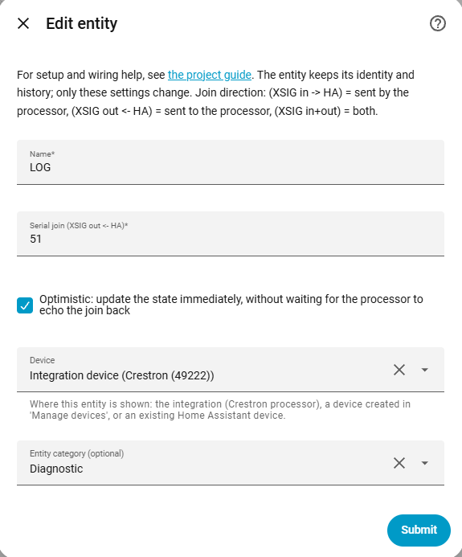
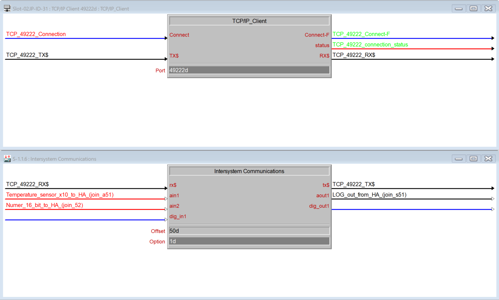

# Text

[← All configuration guides](README.md) · [Wiring reference](../WIRING.md)

A text entity sends a string to a Crestron serial join (**XSIG out ← HA**). If the program also returns text on the same join, the entity can display the received value.

## Form options

| Option | Required? | Meaning |
|---|---|---|
| Name | Yes | Name shown in Home Assistant. |
| Serial join | Yes | Join number 1–1024, sent to Crestron. XSIG supports up to 252 encoded bytes per serial value. |
| Optimistic | Optional; on by default | Immediately show the value HA sent. Turn it off when the program returns the authoritative value and HA should wait for that feedback. |
| Device / Entity category | Optional | See [shared form options](README.md#shared-form-options). |

## Wiring and behavior

- Connect the join to the XSIG **out** side to send text. Also return the value on the **in** side if the entity should display processor-originated updates.
- Serial data is encoded as Latin-1; characters not representable in that encoding are replaced. Keep payloads within 252 encoded bytes.
- Optimistic mode updates HA only after the send is accepted locally; it does not confirm that the SIMPL program processed the string.

